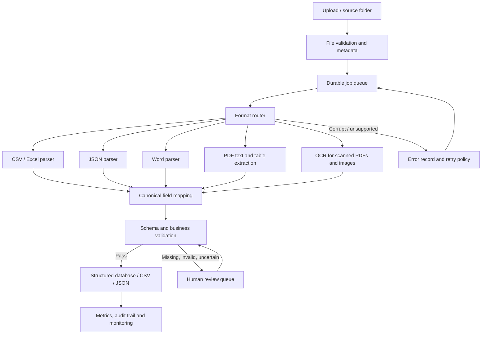

# Technical Proposal: Multi-Format Document Ingestion & Tabularization

## 1. Objective

Build a reliable pipeline that accepts heterogeneous files, extracts relevant data, normalizes it into a canonical schema, validates the results, and emits SQL-ready tables/CSV/JSON. The accompanying Python proof of concept demonstrates the local parsing and normalization path.

## 2. Proposed end-to-end architecture

### Workflow

1. **Ingest:** accept upload or watched-folder event; assign a unique document ID; retain original file in controlled storage.
2. **Preflight:** validate extension and MIME type, size limit, checksum, malware scan, and whether the file can be opened.
3. **Queue:** enqueue a job with document ID, storage key, type, attempt count and status. A durable queue decouples upload from CPU-heavy parsing and supports backpressure.
4. **Route:** choose parser by verified file type, not solely by user-supplied filename.
5. **Extract:** use format-specific parsers. Use OCR only when a PDF page lacks a usable text layer or an image is supplied.
6. **Normalize:** map aliases such as `qty`, `amount`, and `quantity` to canonical fields; normalize whitespace, dates, units and number formats.
7. **Validate:** check schema, required fields, type/range rules, duplicate policy, cross-field/business constraints, and confidence thresholds.
8. **Persist:** save normalized records, source provenance, validation results and document status in a transactional store; emit CSV/JSON when requested.
9. **Review:** route incomplete or uncertain rows to a review queue; reviewers correct fields and approve/reject records with an audit trail.
10. **Observe:** track throughput, processing time, parser failures, OCR confidence, review rate, retry counts and field-level error rates.

## 3. Parser and extraction choices

| Input | Proposed approach | Reason / caveat |
|---|---|---|
| CSV | Python `csv` or pandas | Handles tabular rows; enforce encoding and delimiter checks |
| Excel | `openpyxl` through pandas | Preserves worksheet-based structured values; choose sheets explicitly where needed |
| JSON | Python `json` + `pandas.json_normalize` | Handles nested objects; define expected root shape |
| Word DOCX | `python-docx` | Reads paragraphs and tables; does not process legacy `.doc` without conversion |
| Text PDF | PyMuPDF | Fast extraction of text layers; table/layout interpretation may need extra logic |
| Scanned PDF / images | Tesseract OCR through `pytesseract`; preprocess with Pillow | Local OCR avoids sending sensitive documents to an external API; quality depends on resolution, skew, language and scan quality |
| Complex layouts / low confidence | Layout-aware model or LLM-assisted field mapping behind a strict schema | Useful for varied layouts, but must be constrained, validated, and evaluated; never trust generated values without evidence |

Use deterministic parsers and regex first for known, stable formats. Use NLP/LLM-assisted extraction only when layouts vary or rule-based extraction is insufficient. Keep raw text, page number, bounding boxes where available, and source spans to support auditability.

## 4. Canonical schema and validation

The proof of concept demonstrates a minimal schema:

- `material`: non-empty string
- `quantity`: non-negative numeric value
- `location`: non-empty string
- `source_file`, `source_type`, `page`, `extracted_at_utc`: provenance
- `status`, `review_reasons`: validation outcome

In production, schemas should be defined by document family rather than forcing every file into one universal schema. Quantity values need a unit field (e.g. kg, tonnes, count) and unit normalization before comparison.

Validation layers:
1. **Structural:** required columns/keys, expected root type, row count and schema version.
2. **Type:** numeric quantity, date parsing, allowed enum values.
3. **Completeness:** missing required fields and empty documents.
4. **Business rules:** non-negative quantities, plausible ranges, allowed material/site codes, totals reconciled to source documents.
5. **Duplicate checks:** checksum/idempotency for repeated files; business-key duplicate detection with review instead of indiscriminate deletion.
6. **Accuracy sampling:** labelled evaluation set, field-level precision/recall, OCR character error rate, and reviewer correction rate.
7. **Confidence:** use OCR confidence and extraction evidence; the demo flags missing/invalid values for review but does not claim calibrated confidence scores.

## 5. Error handling and recovery

- Reject unsupported or oversized files with a clear error code.
- Quarantine corrupted or suspicious files; never execute embedded content.
- Retry transient failures with exponential backoff and a maximum attempt count. Do not repeatedly retry deterministic parse errors.
- Use idempotency keys based on document ID/checksum so retries do not create duplicate rows.
- Store per-file status (`received`, `queued`, `processing`, `needs_review`, `completed`, `failed`) and structured error details.
- Continue processing the remaining batch if one file fails.
- Route low-confidence or incomplete records to a human review queue. Preserve original values and reviewer corrections separately.
- Alert on queue age, repeated failures, sudden OCR degradation and spikes in review rate.

## 6. Production deployment and security

A practical production version could use object storage for originals, a durable queue (e.g. RabbitMQ, cloud queue, or Redis-backed queue), isolated Python workers, PostgreSQL for records/status, and a review interface. Scale workers horizontally based on queue depth.

Apply least-privilege access, encryption in transit/at rest, signed download links, retention policies, audit logs, file-size and decompression limits, malware scanning, secrets management, dependency patching, and access controls for sensitive documents. Avoid sending confidential data to third-party extraction APIs without authorization and data-governance review.

## 7. Proof of concept and testing

The included `src/main.py` processes CSV, Excel, JSON, TXT, DOCX, text-based PDFs, scanned PDFs, and images; maps common field aliases; validates required fields; and produces normalized CSV/JSON, a review queue, and an error report.

Suggested tests:
- Valid row maps correctly and receives `validated`.
- Missing material/location or invalid/negative quantity goes to review.
- Corrupted PDF and malformed JSON create an error entry without stopping other files.
- Duplicate files are handled using an explicit idempotency policy in production.
- Scanned sample is evaluated against manually verified expected text.
- Mixed-format files representing the same material yield consistent canonical columns.

## 8. Limitations and next steps

This prototype is local and synchronous, uses a small example schema, and does not implement a durable queue, database, production authentication, or calibrated model confidence. Next steps are to define real document-specific schemas, create a labelled test corpus, measure extraction accuracy, add a queue and persistent job state, and implement a reviewer workflow.
